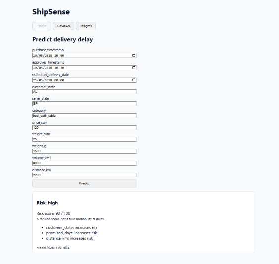
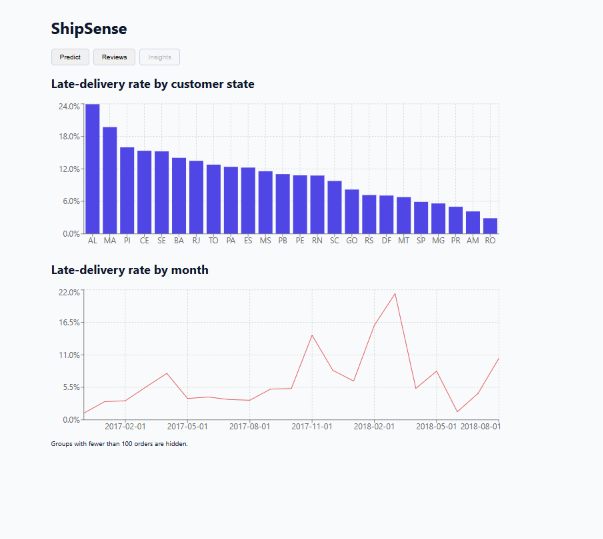

# ShipSense

A full-stack ML application that predicts whether an e-commerce order will
arrive late and analyzes customer review sentiment, built on the public
[Olist Brazilian E-commerce dataset](https://www.kaggle.com/datasets/olistbr/brazilian-ecommerce)
(about 96,000 delivered orders).

## What it does
- **Predict:** enter order details, get a risk level, a risk score and the top
  three factors behind it.
- **Reviews:** classify Portuguese review text as negative, neutral or positive.
- **Insights:** late-delivery rate by state and by month.

## Results

| Model | Metric | Baseline | Result |
| --- | --- | --- | --- |
| Delay (LightGBM) | PR-AUC, validation | 0.053 (always guess) / 0.160 (logistic regression) | 0.184 |
| Delay (LightGBM) | PR-AUC, test | 0.066 (always guess) | 0.089 |
| Sentiment (TF-IDF + logistic regression) | Macro-F1, test | n/a | 0.668 |

Honest reading: the delay model is a modest improvement over guessing.
Order data cannot see weather, carrier strikes or road problems. The late rate
also drifts over time (9.0% train, 5.3% validation, 6.6% test), which a
time-based split exposes. Full experiment log: [docs/05-experiments.md](docs/05-experiments.md).

## Architecture

    Browser (React + Vite + TypeScript)
          |  JSON over HTTP
          v
    FastAPI backend ----> PostgreSQL
          |
          +--> Delay model (LightGBM)
          +--> Sentiment model (scikit-learn)

    Offline: raw CSV -> cleaning -> features -> training -> MLflow
             data and models versioned with DVC

## Tech stack

| Layer | Tools |
| --- | --- |
| Data and ML | pandas, scikit-learn, LightGBM, MLflow, DVC |
| Backend | FastAPI, Pydantic, SQLAlchemy, Alembic, PostgreSQL |
| Frontend | React, TypeScript, Vite, Recharts |
| Quality | pytest, ruff, pre-commit, GitHub Actions |
| Packaging | Docker, docker compose, uv |

## Run it

    git clone git@github.com:dinun0427/shipsense.git
    cd shipsense
    docker compose up --build

Then load the dashboard data (needs the Olist CSVs in `data/raw/`, see below):

    cd backend && uv run python -m scripts.load_order_facts

Open http://localhost:8080 (app) and http://localhost:8000/docs (API docs).

To retrain the models, download the dataset from Kaggle into `data/raw/`, then:

    uv run --project ml python -m shipsense_ml.data.make_dataset
    uv run --project ml python -m shipsense_ml.training.train_delay
    uv run --project ml python -m shipsense_ml.training.train_sentiment

## Project structure

    ml/         data cleaning, features, training code and tests
    backend/    FastAPI app, database models, migrations, tests
    frontend/   React app
    docs/       problem statement, requirements, ML design, experiment log

## Limitations
- Data covers Brazil, 2016 to 2018, delivered orders only.
- The delay score is a ranking score, not a calibrated probability.
- Neutral (3-star) reviews are hard to classify (F1 0.29), and short phrases
  such as "arrived very late" can be misread by a bag-of-words model.

## What I learned
- Splitting by time instead of randomly exposed data drift that a random split
  would have hidden.
- Removing features (month, seller history) improved results, because they did
  not generalize to later periods.
- Docker caught a missing runtime dependency that my laptop had hidden.
